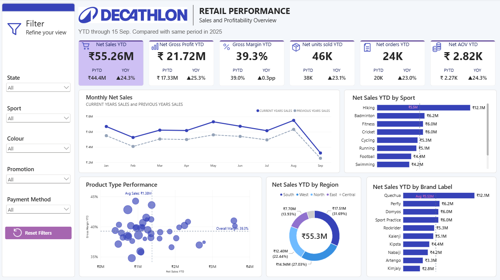

# Decathlon Retail Performance Dashboard | Power BI

## Project Overview
Developed an interactive Power BI dashboard to analyze Decathlon's retail sales and profitability performance. The dashboard compares current-year and previous-year performance to identify sales trends, product performance, regional contributions, and business growth opportunities.

## Business Problem
Retail management needs a consolidated view of sales and profitability to:
- Monitor revenue and gross profit growth.
- Identify high-performing sports, products, and brands.
- Evaluate regional sales contributions.
- Track monthly sales trends and profitability.

## Tech Stack
- Power BI
- Power Query
- DAX
- Data Modeling
- Microsoft Excel

## Data Source
- Platform: Kaggle
- Dataset: Decathlon Retail Sales Dataset
- Tables: Sales, Products, Store, and Date.

## Dashboard Features
- Six KPIs: Net Sales, Gross Profit, Gross Margin, Units Sold, Orders, and Average Order Value.
- Monthly sales comparison (Current Year vs Previous Year).
- Sport-wise and brand-wise sales analysis.
- Product type profitability analysis.
- Regional sales contribution.
- Interactive filters for State, Sport, Colour, Promotion, and Payment Method.
- YTD, PYTD, and YoY performance comparisons.

## Key Business Insights
- Net sales reached ₹55.26M, growing by 24.3% YoY.
- Gross profit increased by 25.3% to ₹21.72M.
- Gross margin improved by 0.3 percentage points to 39.3%.
- Hiking was the top-performing sport with approximately ₹12.1M in sales.
- Quechua recorded the highest displayed brand sales at approximately ₹12.1M.
- South contributed 31.69% of total sales, followed by West at 27.03%.
- Average Order Value increased by 24.3% to ₹2.82K.

## Business Recommendations
- Focus on improving margins across low-profitability product types.
- Strengthen high-performing sports and brand categories.
- Identify growth opportunities in regions with lower sales contributions.
- Explore cross-selling and product bundling to increase average order value.
- Use monthly sales trends to support future sales planning.

## Business Impact
The dashboard enables management to monitor business performance, identify profitability improvement opportunities, evaluate regional and product contributions, and make informed commercial decisions.

## Dashboard Preview

